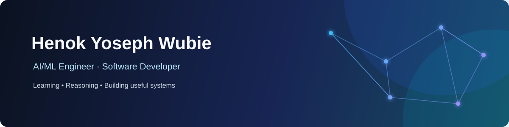
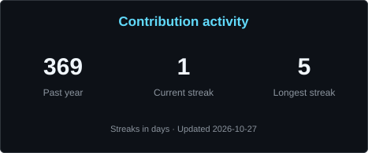
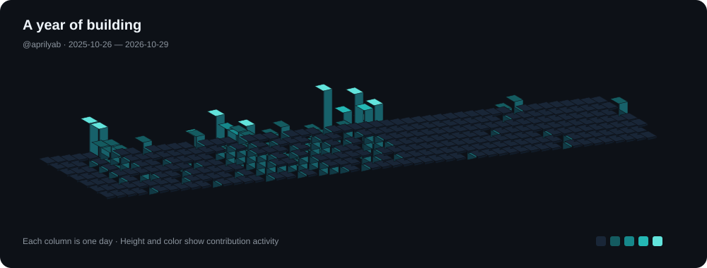

### Connect with me

  
  
  

## About me 👋

I’m **Henok**, an AI/ML Engineer at [iCog Labs](https://icog-labs.com/) and a Computer Science student at [Addis Ababa University](https://www.aau.edu.et/).

- 🔭 **Currently building:** AI agents, GraphRAG experiments, and pattern-mining systems
- 🌱 **Currently learning:** reliable AI systems, model deployment, and distributed systems
- 💬 **Ask me about:** Python, machine learning, NLP, computer vision, and data pipelines
- 🤝 **Open to:** open-source collaboration and practical AI/ML projects

### Skills

**Languages**

  
  
  
  
  
  

**AI & data**

  
  
  
  
  
  

**Engineering & tools**

  
  
  
  
  
  
  

### 📊 GitHub stats

  
  

## Projects worth exploring

<table>
  <tr>
    <td width="50%"><a href="https://github.com/aprilyab/Neuro-Symbolic-AI-Guardrail-System"><strong>Neuro-Symbolic AI Guardrail System</strong></a> Neural models and symbolic constraints for safer AI systems.</td>
    <td width="50%"><a href="https://github.com/aprilyab/GraphRAG-Galaxy-agent-xp"><strong>GraphRAG Galaxy Agent</strong></a> Graph-grounded retrieval and agent experimentation.</td>
  </tr>
  <tr>
    <td><a href="https://github.com/aprilyab/Medical-Decision-Intelligence-via-MAS"><strong>Medical Decision Intelligence</strong></a> A multi-agent approach to structured decision support.</td>
    <td><a href="https://github.com/aprilyab/cordial-f1r3node"><strong>Cordial f1r3node</strong></a> A Rust implementation of a DAG-based consensus protocol.</td>
  </tr>
  <tr>
    <td><a href="https://github.com/aprilyab/MettaWamJam"><strong>MeTTa WAM Jam</strong></a> HTTP infrastructure for MeTTa execution workflows.</td>
    <td><a href="https://github.com/aprilyab/credit-risk-model"><strong>Credit Risk Model</strong></a> A classification workflow for loan default risk.</td>
  </tr>
</table>

  

